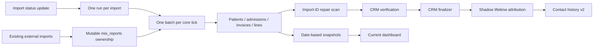
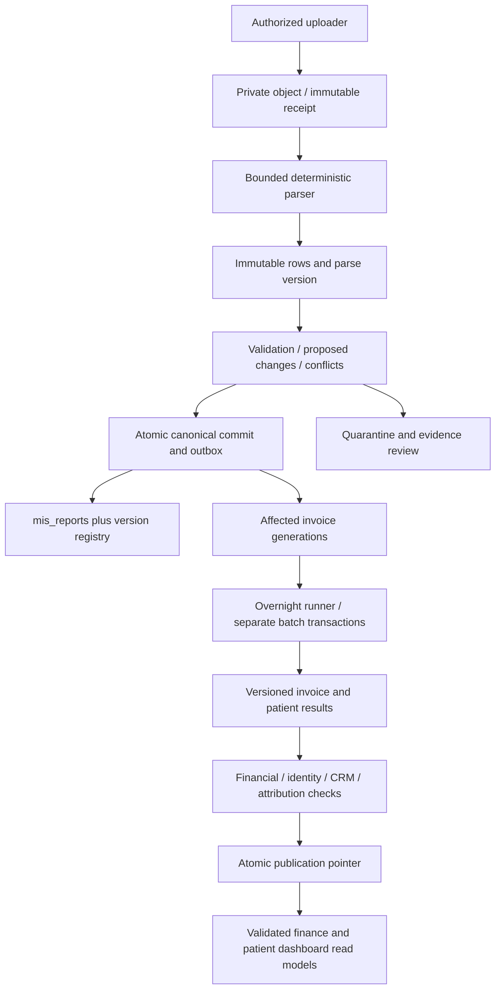

# MIS Upload Gateway — implementation plan

Status: **first implementation prepared on a local branch; not deployed**. This branch contains the read-only schema/migration baseline, authorization hardening migration, immutable receipt/parse/row staging schema, and CSV parser/tests. No production writes, migration applications, deployments, or cron changes were made. Prepared from the complete `CODEX_INSTRUCTIONS_MIS_UPLOAD_GATEWAY.md` and read-only repository/database inspection. The attachment is the design brief; its historical assertions were independently checked below.

## 1. Recommendation and readiness

Build an additive intake and source-version layer around `public.mis_reports`, retain the existing CRM and finance entities, and replace import-owner-based reconciliation with generation-specific affected-invoice work. Preserve existing source bytes before enabling any canonical writes. Do not expose the uploader using the current role authorization without first protecting role assignment.

**The additive MIS upload delta is scoped for a live CLI dry run; it is not approved or ready for production activation.** The active migration directory now contains only the three authorization/intake migrations, and the prior 13 legacy files are retained outside the CLI path with hashes. A local allowlist check passes. A linked live `db push --dry-run` still must verify the target and exact pending set. The separate 601-entry historical source gap still blocks a clean database rebuild. Authorization, source revision/completeness, transaction-safe workers, and versioned dashboard publication remain release gates.

The first implementation includes the baseline/fixture audit harness, immutable receipt/row/attempt/validation tables and their access controls, offline CSV parser tests, and profile-role protection prerequisite. The follow-up baseline fix archives stale migration versions, adds the minimal Supabase CLI config and a hash-checked three-migration deployment scope. Keep gateway activation off; do not attach triggers to or alter canonical MIS, activate workers, provision a Storage bucket, or switch dashboards. The private object upload path and source-byte verification must be delivered before accepting files; the current migrations do not store uploaded bytes. See [delivery backlog](mis-upload-gateway-delivery-backlog.md), [test matrix](mis-upload-gateway-test-matrix.md), and [migration deployment scope](database-baseline/mis-upload-deployment-scope.md).

## 2. Evidence and inspected state

### Repository and connection

| Evidence | Verified result | Confidence / limit |
|---|---|---|
| Repository | `magfurealam-del/ekagra-dashboard`, local `ekagra-dashboard/`, HEAD `8886261316a4ffef3993fe1e6090d081aa6ecf0a` | High; local working tree has existing modifications and untracked migrations; leave them intact |
| Framework | App Router under `app/`; local package declares Next `^16.2.10`, React `19.2.4`, supabase-js `^2.109.0`; no upload/parser/test framework dependencies | High for checkout, not deployed build |
| Instructions | `AGENTS.md` requires reading installed Next docs before coding | This phase creates documentation only; implementation must read `node_modules/next/dist/docs/01-app/01-getting-started/15-route-handlers.md` |
| Project binding | `supabase/.temp/project-ref` and connector agree: `youqgrwovfyqqsnbtcnm`, “Ekagra Dhanmondi Finance and Call Center” | High |
| Database | PostgreSQL 17.6, ACTIVE_HEALTHY, Tokyo region | Connector project metadata |
| Audit clock | Live `now()` = `2026-10-23T02:14:26Z` at initial inventory; client date October 22 in America/New_York | Consistent across time zones; use database UTC for evidence and Asia/Dhaka for business dates |
| Migration ledger | Live latest `20261022235907_mis_admin_only_pipeline_health_endpoint_20261023`; local files stop at September 28 | Serious drift; October worker/attribution definitions absent locally. Earlier local and applied migration timestamps also differ |
| Storage | `storage.buckets` returned no rows | No bucket currently provisioned in this project |
| Edge runner | `mis-reconciliation-runner`, deployed v2, returns HTTP 410 `Disabled` | ACTIVE metadata does not mean operational code |

Read `pg_get_functiondef` for core worker, dimension/invoice steps, queue/trigger/fingerprint/validation, repair, strict appointment verification, finalizer, shadow attribution, contact history, recovery and health functions. Inspected table columns, constraints, indexes, grants, policies, triggers, applied migrations, cron definitions and seven-day execution aggregates. No reconciliation function was executed, including functions labelled preview: those can still write or acquire locks.

Other active Edge Functions include OCR sync/probe, Messenger/webhook processors, ads enrichment and attribution/backfill probes. Their code was not exhaustively audited; only the MIS runner body was retrieved. Deployment settings, GitHub write permission, Vercel effective duration/cron configuration, backups/PITR and external consumers remain release dependencies, not verified facts.

### Source and reconciliation baseline

| Import | Original file | Declared rows | Currently owned canonical rows | Status |
|---|---|---:|---:|---|
| 1 | Report.csv | 20,121 | 18,289 | completed |
| 2 | Report (1).csv | 2,674 | 0 | failed |
| 3 | Report (3).csv | 5,513 | 4,966 | completed |
| 4 | Report (4).csv | 3,436 | 3,436 | completed |

Live totals: **26,691 MIS rows; 12,124 normalized invoice IDs; 1,242 distinct source hospital numbers; latest invoice date October 20, 2026**. All 12,124 downstream invoices are `matched`; all 12,124 repair-queue rows are `completed`. This does not prove complete historical export coverage or accurate clinical attendance.

Signed MIS `sum(net_sales)` = **19,968,826.4316 BDT**; `sum(invoices.net_bill)` = **20,600,599.35 BDT**. These are different measures, intentionally not an equality assertion. Source money is `numeric(18,4)`; per-line and per-invoice two-decimal rounding must be tested separately. Open review views contain 274 attendance cases and 278 conversion cases; contact history records 12 identity conflicts. Preserve these unresolved cases.

`Report.csv`, `Report (3).csv`, `Report (4).csv` exist in `C:/Users/magfu/Downloads`. Read-only CSV profiling confirmed 20,121 / 5,513 / 3,436 records and exact hash matches to imports 1 / 3 / 4:

| File | SHA-256 |
|---|---|
| Report.csv | `5b8593dce2b993125ee6b53eee585a08c1b7f60f668d44551d3c843be39838e5` |
| Report (3).csv | `68f090e11c3d97f0dc88abbe252aceac97f1a30ecf6ca38caed0f3df2ae4096e` |
| Report (4).csv | `77343acfab3dc85de06043b5620d488494ee7033eb465d4ce7b2ca4ef0f1d54a` |

Using lowercase/trimmed invoice and item solely as a profiling candidate: no repeats within these files or current MIS. Pairwise overlaps are 1,739 (1/3), 179 (1/4), and 547 (3/4). All overlapping raw records differ; financial fields differ textually in 1,216, 179 and 279 respectively. Textual change is not necessarily a numeric change; implementation must compare normalized decimals. There is no revision/as-of or source line ID header. File suffix/order/mtime is not correction authority. The files allow genuine history restoration; current ownership rows alone do not.

### Database contracts that affect implementation

* `mis_report_imports`: unique file SHA-256 (both constraint and redundant partial index), original row count, source format/reference year, status. `mis_reports`: surrogate ID, mutable import ownership, `(import_id,source_row_number)` unique, invoice/item raw IDs, patient/admission/date/dimensions, five monetary columns, `raw_row`. There is no enforced business-line uniqueness.
* Many source columns are NOT NULL, including demographic fields, age/birth year and all financial fields. Blank-to-NULL cannot be implemented honestly without a compatibility migration. `invoice_datetime` is currently a **date**, not a timestamp. Birth-year CHECK ends at 2026; dimension code also hardcodes 2026 and synthesizes January 1 DOB.
* Only enabled MIS source trigger is `trg_safe_mis_import_queued`, AFTER UPDATE OF status on imports, calling `mis_internal.trg_import_queued()`. No active trigger on every `mis_reports` row was found. Old public `trg_queue_mis_import`, `trg_queue_mis_rows`, `queue_mis_reconciliation` still exist as functions; existence is not attachment.
* `queue_import` and trigger compare `source_row_count` with current `mis_reports.import_id` ownership. `source_fingerprint` hashes mutable rows with MD5 and row IDs. One reconciliation run is unique per import; `queue_import` does not restart a completed run. These contracts cannot model independently versioned corrections.
* Core `worker_tick` selects one run, executes one batch, and returns. Invoice, line, CRM and finding stages limit 50 / 25 / 50 / 50 invoices; other stages limit 100 keys. Advisory transaction lock `(806731,7001)`, local worker flag, timeout declarations, checkpoints, exponential retries and ledger are useful patterns.
* `step_invoices` selects only rows owned by one import, chooses the first header, replaces line sequences and deletes surplus rows. A partial overlapping import can produce a partial invoice. It assigns line `qty=1`; never present this as completed therapy session quantity. Latest eligible CRM lead is selected for billing links, not necessarily patient acquisition. Existing links to superseded leads are not comprehensively removed.
* `step_dimensions` selects last row by database ID for demographics/admissions, uses phone as a secondary identity key, and uses `coalesce` to retain some old values. This can prevent explicit corrected NULLs and leave admission status stale after discharge corrections. Catalog duplicate findings still permit other code to choose `min(id)`; ambiguity must not silently resolve that way.
* `downstream_repair_queue` primary key is invoice ID, with source import ID and three attempts. Repair tick scans all MIS and requeues only when import ID changes. Same-import edits or changed dependency rules do not trigger repair. Repair function fills missing classification/links, rather than always invalidating and recomputing corrected ones.
* Live downstream triggers exist on patients, admissions, invoices and invoice lines (identity, care setting, authority, audits, OT shares, backlog sync). Audit every called trigger for worker-mode behavior in the baseline PR. Never globally disable triggers or set replication role. A caller-controlled GUC is not authorization.
* Import/run 3 is completed but retains an old validation error; run 4 has 172 batches. At 30 core ticks/night, 172 one-batch ticks require at least six nights. Recorded daytime/manual completions are not evidence of unattended overnight capacity.

### Security findings

**Release blocker:** `authenticated` has UPDATE privilege on `user_profiles.role`; its self-update policy checks only `id=auth.uid()`. The only inspected trigger on this table sets `updated_at`. This is a potential self-role elevation path based on grants/policies; no exploit was attempted. Protect `role`, `is_active`, identity and password-control fields with column grants plus a privileged, audited role-management RPC. Recheck every role-granting RPC before trusting `is_admin()`.

MIS tables have RLS but authenticated SELECT policies use `true`; source PII is broadly readable to authenticated users. Keep `mis_internal` outside PostgREST's exposed schemas, add defense-in-depth RLS to new tables, and grant no direct table access to browser roles. A narrowly scoped schema/function grant may be needed for an invoker wrapper to call one private `SECURITY DEFINER` routine; it must not imply blanket table access. A dedicated execution role and narrow public RPC wrappers are preferable to broad service-role access.

Some core function settings show a single quoted `search_path` entry `'pg_catalog,public,mis_internal'`, unlike later separate entries. All new functions must use explicit qualified names and `SET search_path = ''`; test legacy resolution on a clone rather than treating current idle success as verification.

M00 must also replace broad authenticated MIS read policies with approved staff capabilities after inventorying current consumers. Hiding upload screens does not protect raw tables already readable through the Data API. Preserve legitimate staff read access through scoped views/RPCs; do not apply a blanket policy change without consumer regression tests.

### Schedules and reporting

`cron.timezone=GMT`. Dhaka is UTC+06 year-round; the allowed window is **18:15 UTC on the preceding day through 01:45 UTC, exclusive**, corresponding to 00:15–07:45 Dhaka. Use `clock_timestamp()` for cutoffs; `now()` remains fixed during a transaction.

| Jobs | Current UTC schedule | Dhaka role / observed history |
|---|---|---|
| 80 / 81 / 82 | `15,30,45 18`; `0,15,30,45 0,19-23`; `0,15,30 1` daily | Core at 00:15…07:30, 30 ticks/night. 60 failures across October 16–18 in seven-day sample; recent 150 successes. Failures were run-status CHECK rejection, now expanded in live schema |
| 83 / 84 / 85 | +5 minutes after core | Repair at 00:20…07:35, 100 invoices/tick, theoretical 3,000/night. 60 successful recorded calls, 3.5–5.1 s average by job; may be idle/full-scan cost |
| 87 / 88 / 89 | +10 minutes after core | Snapshot refresh at 00:25…07:40. 88/89 have 23/3 successes; 87 has no run in inspected seven-day history; verify next eligible execution |
| 90 | `40 1 * * *` | CRM finalizer 07:40; one success, 5.31 s |
| 92 | `43 1 * * *` | Shadow attribution 07:43; one success, 9.46 s |
| 93 | `44 1 * * *` | Contact history 07:44; one success, 1.13 s |
| 94 / 95 | `17,47 18-23,0`; `17 1` daily | Queue recovery; 2/1 observed successes |
| 96 | `37 1 * * *` | Health before finalizers, 07:37; one success, 6.47 s |

SQL success can mean idle, deferred or a caught business failure. Recent core successes take <0.2 s and do not establish loaded throughput. Old job 86 appears in history but not current schedules.

`refresh_dashboard_snapshot_tick` has no upstream dependency check and refreshes each date range only once per local day. The finalizer has useful upstream count/status checks, but refreshes snapshots before the outer integrity function makes additional corrections. Shadow attribution/contact history have upstream checks, but date/count equality cannot detect a corrected June invoice when latest source date stays October 20. Separate advisory locks allow stages to overlap.

Local `vercel.json` also schedules invoice correction at 03:00 UTC (**09:00 Dhaka**, outside window), snapshot refresh and outgoing calls at 00:00 UTC (06:00 Dhaka), Messenger reconciliation at 20:00 UTC. The correction route calls `cron_sync_appointment_status_from_invoices`; the snapshot route calls `refresh_dashboard_metric_snapshot_cron` directly. Effective production Vercel configuration is unverified. Include these paths and the admin page's manual refresh/recompute controls in the activation audit; changing pg_cron alone is insufficient.

`app/admin-dashboard/page.tsx` reads `dashboard_metric_snapshots`, `get_admin_source_performance`, `get_ad_attribution_report`, and agent metrics. The inspected first two source/ad RPC definitions do not reference the new shadow/contact-history tables. Patient detail directly reads patients, leads and appointments. New CRM source RPCs exist in live migration history, but this checkout does not consume them. Therefore **do not claim shadow lifetime attribution is already the UI source of truth**.



## 3. Target architecture and invariants



Hard invariants:

1. Original byte hash, object identity, received time and parsed source rows never change. Every upload attempt is auditable, including duplicate, rejected and abandoned attempts. Parser reinterpretation creates a new parse version, not edited rows.
2. The canonical business identity and payload fingerprint are different things. A changed amount is a new version of the same line when identity is proven, not a new line key.
3. Corrections require source-issued revision/as-of evidence with defined scope or an explicit audited supersession decision. Arrival time, invoice date and import ID are not authority. Equal authority with different payload is a conflict; stale authority cannot overwrite newer state.
4. Canonical source commit and affected-work enqueue are one database transaction. No committed source change without an outbox record; no downstream execution inside intake.
5. Reconcile the **whole canonical invoice at a pinned generation**, including unchanged lines from earlier files. Never reconcile only rows with the newest import ID.
6. Publishing a version means all required stages for that version passed. Failed/quarantined uploads retain evidence, and last good dashboards remain visible. No partial new source/old attribution mixtures.
7. Only identity-consistent, qualifying clinical invoice evidence verifies a visit. Financial invoice existence, package sale or medicine purchase alone is not attendance/session proof.

### Identity, completeness and correction rules

Preferred key: `(source_system, facility_id, source_line_id)` from a documented upstream line identifier. No such field is present in the inspected files. For the legacy 32-column template, `(normalized_invoice_id, normalized_item_id)` is a **conditional candidate**, allowed only after exporter/finance confirmation that each row is a stable aggregate at that grain. Current uniqueness is insufficient proof. Until then allow immutable intake/preview; quarantine colliding or changed candidates from automatic commit. Never add occurrence index, amount, date or row number as a fake stable key.

A future detail template with legitimate repeated item IDs must supply a stable discriminator (source line/charge event ID). Repeated identical rows may be legitimate repeat charges: preserve all raw rows and require the template's explicit duplicate semantics. For confirmed aggregate templates, exact duplicate payload candidates can be marked `duplicate_in_file`; inconsistent duplicates quarantine the entire invoice. Do not merge patient identities by phone or name.

Each accepted export must declare `export_mode` (`line_delta` or `complete_invoice_snapshot`), source namespace/facility, authority revision, coverage range and completeness evidence. A line delta changes only named stable lines. A complete invoice snapshot can tombstone omitted lines **only with certified invoice completeness**. Missing records from a date-filtered report do not mean deletions. Without counts/trailer/export manifest, truncation at a syntactically valid record cannot be reliably detected; finance must certify scope or intake remains non-destructive/draft. No silent assumption that a header-complete CSV is a complete invoice.

Moved invoice number: treat as retire old key plus create/associate new key only with explicit lineage evidence. Queue both old/new invoice, patient, admission and date dependencies. Source revision authority must cover the old key too. Patient or date changes never mutate acquisition ownership without recomputing both affected patients' complete observed histories.

## 4. Data model (all objects below are proposed unless labelled existing)

New tables live in `mis_internal`; no raw PII table is added to public. UUID file/attempt IDs; bigint generated IDs for ordered generations. Foreign keys RESTRICT history deletion. Timestamps timestamptz; business dates date; money `numeric(18,4)`, downstream rounding explicit. New types use CHECK constraints over documented states, with migration tests for every emitted state.

| Proposed object | Required columns and constraints | Index / access |
|---|---|---|
| `mis_upload_files` | `id uuid PK`, source namespace/facility, `sha256 text` 64-hex CHECK + namespace/hash UNIQUE, `storage_path UNIQUE`, byte_count, original_name, media_type, received_at/by, legacy_import_id nullable FK, `retention_class`, object checksum verification; immutable after receipt sealed | Namespace/hash unique; no UPDATE/DELETE to app roles; receipt becomes immutable only after successful object verification; lifecycle in separate state table |
| `mis_upload_state` | `upload_id PK/FK`, state, active_parse_id, active_preview_id, commit_id, optimistic `state_version`, heartbeat/error summary | State updates via narrow RPC; no client-supplied actor |
| `mis_upload_attempts` | UUID PK, file nullable FK, actor, request idempotency UUID UNIQUE per actor, start/end, outcome/reason, duplicate_of, bounded error metadata | File/time and incomplete attempts; append outcome events rather than overwriting source |
| `mis_upload_parses` | ID PK, file FK, parser_version, schema_version, normalization_version, reference_year, source revision/evidence, mode, expected rows/sheets, rowset_sha256, sealed_at; UNIQUE(file, parser/config digest) | Once sealed immutable; reference year persisted, never recalculated from current year |
| `mis_upload_rows` | parse_id FK, worksheet stable name/index, row_no positive, raw_cells array with header order/type/lexical values, normalized jsonb, payload_sha256; PK(parse_id,worksheet,row_no) | Index normalized invoice candidate; stage chunks idempotent by PK + digest, conflicting retry fails; parsed blank rows recorded with explicit disposition |
| `mis_import_validations` | ID, parse/preview/commit FK, check code/version, outcome, observed/expected metrics, row/invoice reference, timestamp | Append-only. No patient names in generic error messages; protected row-level error download |
| `mis_upload_previews` and `mis_upload_row_decisions` | Preview ID, parse ID, base generation, rule version, expiry, proposal digest; per-row decision/new/unchanged/correction/stale/duplicate/rejected/conflict and current-version dependency | UNIQUE(preview,row identity); preview is immutable and recomputed after dependency conflict |
| `mis_canonical_line_keys` | ID PK, namespace/facility, key_version, `business_key text`, `mis_report_id bigint UNIQUE FK`, current_version_id FK, current_generation; UNIQUE(namespace,facility,key_version,business_key) | Preserve existing MIS surrogate IDs. Keep old aliases in separate immutable lineage table for key correction |
| `mis_source_line_versions` | ID PK, key FK, generation FK, source row FK, previous_version_id, normalized before/after payload + digests, authority revision/evidence, correction reason, tombstone flag, rule_version, actor/time; UNIQUE(key,generation) | Immutable; `(key, authority_revision)` conflict checked under lock; `previous_version_id` chain validated |
| `mis_source_commits` | monotonic generation PK, upload/preview FK, base generation, canonical manifest hash, counts, signed totals, authorizing actor, committed_at; UNIQUE(upload,preview) | Immutable commit manifest; compare-and-swap at commit |
| `mis_changed_invoice_queue` | composite PK `(namespace,invoice_key,generation)`, reason, old/new patient/admission/date dependency JSON, state, attempt_count, next_attempt_at, lease_owner/token/expiry, completed_generation, result hash | Partial index `(next_attempt_at,generation,invoice_key)` for ready/retry; no FK requiring invoice to exist before reconcile |
| `mis_reconciliation_attempts` | work PK reference, stage, lease token, start/finish/outcome, rows and money metrics, error category, rules version | Append audit; UNIQUE(work,stage,attempt); retain existing batch ledger as legacy audit |
| `mis_publication_runs` | ID PK, target_generation, rules version, source manifest hash, stage completion digests, validation status, coverage evidence, start/end, last good predecessor | Unique target/rule; no new publication if dependency watermark differs |
| `mis_publication_pointer` | one row per facility, published_run_id FK, generation, switched_at/by | CAS/row lock only; readers resolve all snapshots through this pointer |
| `mis_published_*` read models | invoice/line, patient summary, encounter, acquisition, invoice attribution and dashboard metrics keyed by publication ID and stable entity key | Immutable version outputs, patient/date/source indexes; narrow staff/admin RPCs return no more PII than role permits |

Supplement with a private authority-decision ledger (reviewer, evidence object, supersedes version, scope) and immutable event log for status transitions. Do not overload existing reconciliation runs' one-import uniqueness to support multiple corrections. Link new commits/runs back to legacy imports without changing their declared counts/status history.

**Legacy backfill:** restore verified original bytes/rows for imports 1/3/4 into the new ledger after approval, marked `legacy_original_verified`. Import 2 is a failed intake, not deleted history; profile/recover it separately. Seed current canonical version history as `legacy_observed_at_baseline` with current row images, preserving IDs and import ownership. Do not pretend an observed canonical row equals its original source version. Build an explicit discrepancy map; never change canonical values while reconstructing original files. Do not auto-replay historical files to production.

**Blank semantics:** staging always preserves missing versus empty versus numeric zero. Normalization converts approved blank strings to SQL NULL. Keep invoice ID/date/required line identity mandatory for canonical acceptance; rows missing those remain quarantined. Migration M03 drops NOT NULL only on optional demographic/age/financial fields whose missingness is permitted by the approved template; incomplete financial rows cannot publish. Do not fill missing financials with zero. Replace year-2026 assumptions with versioned reference-year validation; estimated birth year is not an exact DOB. Preserve raw `Invoice Datetime`; add a real timestamp only if timezone/time precision is supplied, leaving the existing date column compatible.

**Retention:** never auto-purge committed source evidence/history. Propose retained-until-finance/privacy-approved policy; unresolved retention duration and legal holds are launch dependencies. Abandoned unsealed objects can expire after seven days only when no receipt/parse references them; retain attempt metadata. Application append-only controls are not protection from a database owner or Storage administrator. If regulatory WORM is required, add separately managed immutable object backups; do not claim Supabase bucket policies alone provide WORM.

## 5. Parser and intake protocol

Choose Node.js TypeScript shared library under `lib/mis-upload/`: `csv-parse` with BOM handling, strict column count, no cast/date auto-conversion; ExcelJS for workbook structure/formula/sheet metadata; decimal.js for exact arithmetic. Pin audited versions in lockfile during implementation. XLSX financial values must be read as OOXML lexical decimal tokens through a bounded ZIP/XML reader, not ExcelJS JavaScript Number conversion; reject disagreements between workbook cell interpretation and raw token mapping. Use a SAX parser with external entities disabled and a ZIP entry scanner with expansion accounting. These additional libraries also require version pins/security review. Reject `.xls`, `.xlsm`, encrypted and macro-enabled files in v1; legacy `.xls` is optional, not a launch requirement.

Proposed initial limits: 20 MiB compressed/uploaded, 100 MiB expanded, 1,000 ZIP entries, expansion ratio 100:1, 50,000 data records, 64 columns, 64 KiB field, one recognized data sheet. Reject before allocating full expansions; 512 MiB parser RSS ceiling and 30 s parsing budget are release tests, not claimed measurements. Large raw files go directly to private Storage through short-lived, path-scoped authorization; do not proxy file bodies through Next routes. `Report.csv` is 6.57 MB: use resumable TUS upload, not reliance on small-file standard upload reliability. Server re-reads bytes and computes SHA-256; client hashes are hints only.

Exact inspected template v1 headers, including exporter spelling:

```text
Doctors Deparment | Hospital Number | Patient Name | Gender Data | Age |
Phone Mobile | M Status Data | Blood Group | Address | Patient Type |
Bill Module Name | Admission Id | Admission Date | Dis Date | Invoice Id |
Invoice By | Invoice Date | Invoice Datetime | Doctor Name | Second Doctor Name |
Contributor Doctor Name | Mpo Name | Parent Itemtype Name | Item Type Name |
Bu Name | Item Id | Item Name | Sales Amt | Item Disc | Net Sales | Net Coll | Cancel Amt
```

Map via an explicit schema registry, including approved aliases only (e.g. correcting `Doctors Deparment` spelling in a new schema). Reject duplicate headers, unknown required shape, unexpected extra fields unless the schema explicitly allows them. Preserve original order and spelling. UTF-8/BOM accepted; alternate encoding only in a versioned template, not guessed. Preserve HN/item/invoice leading zeros and original case; canonicalization is separately versioned and collision checked.

Dates: schema v1 uses strict DD/MM/YYYY with real calendar validation. `01/02/2026` means February 1 under that approved contract; without a declared date format, flag ambiguous date instead of guessing. Never JS `Date.parse` arbitrary text. Excel serial dates require workbook 1900/1904 calendar declaration, fake leap-day rejection and explicit timezone rules. Age `35Y 3M 21D` gives age_years=35 and birth_year=1991 for persisted reference_year=2026; retain months/days raw. Reject impossible ages and no silent time-dependent recomputation.

Money: accept signed decimal lexical forms approved by schema, reject thousands/currency syntax unless explicitly mapped, reject precision overflow and >4 fraction digits pending explicit rounding contract. Amount zero is different from missing. Store raw and exact normalized decimal strings. Derive line-rounded amounts and invoice-rounded sums separately; include cancellation semantics and refund rules version.

Workbook preflight: default reject formulas in data cells, even with cached results; cached results are not trustworthy recalculation. Never evaluate formulas/external links. Reject hidden populated sheets, merged data cells, macros, external relationships, multiple candidate sheets and unrecognized populated sheets. Permit a documented metadata sheet only in a schema that hashes and validates it. CSV error downloads neutralize leading formula characters; original downloadable bytes remain unchanged with attachment disposition and safe content type. No workbook preview rendered as HTML.

Row accounting: `raw_data_rows = new + corrected + unchanged + stale + duplicate_in_file + rejected + conflicted` for a sealed preview, each mutually exclusive. Accepted is a derived subtotal, not another bucket; superseded counts versions retired, not an extra raw row. Track structural blank/footer rows separately so file coordinates and parsed counts remain auditable. An invoice with any required-field/identity/completeness conflict is wholly quarantined; v1 commit is all-or-nothing for the chosen file, avoiding partial-file ambiguity. Users fix the upstream file or obtain an audited authority decision and re-preview; they do not edit original staged cells.

Identical file upload returns existing receipt and outcome, adds a duplicate attempt event, and does not repeat parsing/reconciliation. An explicitly requested parser upgrade creates a separate parse version under the same file receipt and requires its own preview/approval. Object upload may finish before DB receipt; use reserved upload UUID, conditional INSERT/no-upsert object, checksum verification, seal transaction and orphan reconciliation. Do not claim Storage and Postgres share a distributed transaction.

## 6. Atomic canonical commit and affected work

Commit API requires validated immutable preview ID, expected base generation and request idempotency key. Recheck current user permissions server-side; a preview from another admin cannot bypass file authorization. Stable key authority is an eligibility condition, not an administrator's unchecked client field.

```sql
-- PSEUDOCODE; implement in a private RPC, not SQL pasted into production.
BEGIN; -- SERIALIZABLE; bounded retries on 40001/40P01
-- Lock the facility commit pointer, then affected business keys in sorted order.
SELECT generation FROM mis_internal.mis_source_head
 WHERE facility_id = :facility FOR UPDATE;
-- Revalidate preview digest, sealed row count/hash, source authority, base versions.
-- Same request/commit already completed -> return the durable earlier result.
-- Changed dependency -> return stale_preview; do not apply an obsolete preview.
-- Allocate generation G. For each classified source row:
-- identical key+payload -> append provenance decision only; no canonical UPDATE;
-- newer authoritative version -> append before/after version; update same MIS ID;
-- new proven identity -> insert MIS and registry+first version;
-- stale version -> audit no-op; unordered/equal-revision conflict -> abort/quarantine.
-- Tombstone only with explicit deletion or certified full-invoice replacement.
-- Build affected keys from BOTH old and new invoice/patient/admission/date values.
INSERT INTO mis_internal.mis_changed_invoice_queue (...)
 SELECT DISTINCT ..., G, 'ready', ... FROM changed_dependency_union
 ON CONFLICT (...) DO NOTHING;
-- Seal manifest and outbox once. Legacy imports are linked, not row-count rewritten.
-- No finance/CRM function calls and no per-row downstream triggers on source staging.
COMMIT;
```

Add proposed `mis_source_head(facility_id PK,generation)` in M03 to support this lock. Source commit at this size must fit a measured short transaction (target <=15 s, hard <=30 s, lock wait <=1 s); do **not** chunk visible `mis_reports` mutations across HTTP calls. Immutable parse/preview may checkpoint in 1,000-row chunks; final canonical merge and outbox remain atomic. If the 50k-row limit cannot meet this gate, reduce admitted file size or build an inactive candidate source generation and atomic active-source view switch in a separately reviewed extension. Do not silently ship half-commits.

Existing imports metadata must remain compatible: add nullable gateway commit linkage and an intake-kind discriminator in M03. Gateway commit writes its existing import metadata in a gateway-specific lifecycle that M04 excludes from legacy count-based trigger/recovery paths. One outbox event is the sole gateway queue mechanism. Legacy imports retain the existing trigger path until retired with evidence. Test this transition before enabling commit; otherwise legacy trigger can reject overlap counts or double-enqueue.

Canonical business keys cannot use `(import_id,row_number)`. New rows use their true originating coordinates; unchanged rows retain legacy ownership. Registry/current version identifies latest authority independent of import ownership. If two proposed corrections try to assign the same legacy `(import_id,row_number)`, do not rewrite coordinates to avoid the constraint; source versions reference actual parse coordinates and canonical ownership remains origin metadata.

## 7. Worker, correction propagation and publication

### Worker unit and orchestration

Use the existing queue/ledger concepts, but add `mis_internal.process_gateway_batch` and a narrow server-only RPC wrapper. Each batch processes up to 25 **complete invoices** through dimensions, header/lines, finance validation and affected dependencies. Queue generation identifies exact source versions, reconstructed from version history/current version manifest. Do not read a moving latest rowset between stages. At the single-invoice level commit all required entity mutations together; oversize invoices go to an explicitly bounded large-invoice lane, not silently split into visible fragments.

Run a proposed Next server route `app/api/cron/mis-upload-worker/route.ts` with `maxDuration=60`, work deadline 45 s, up to 30 separate RPC calls, each hard timeout <=5 s and target p95 <=2 s on the representative clone. Each RPC is its own transaction; **a loop inside a SQL function called by SELECT is not multiple committed batches**. The runner stops on deadline, cutoff, empty queue or resource limit. Rate/batch counts are dynamically bounded; do not promise 30 calls when latency allows only 8. If 60 s is not available on the actual deployment, activation is blocked pending a verified worker host or a lower measured throughput SLO.

One runner lease per facility, 90 s expiry, heartbeat after each RPC, monotonically increasing fencing token. A new lease owner cannot race a late previous request: every mutation checks token and queue version under row lock; expired owner cannot mark completed. Advisory transaction lock protects concurrent batch claims and use `FOR UPDATE SKIP LOCKED`. No transaction spans the HTTP loop. Hard statement timeout must be set at the connection/request transaction boundary, not assumed effective merely because a SQL function contains `SET statement_timeout`. Verify actual cancellation on clone.

Retry lock/transient errors with bounded exponential delays (15,30,60,120 minutes; max five attempts), capped to the next allowed window. Deterministic data errors quarantine/dead-letter immediately with reason. Killing a process after SQL commit but before HTTP response retries idempotently. Lease recovery may queue at any time; downstream mutation remains overnight-only. Use database clock at entry and before each batch; stop taking work early enough for hard timeout to finish before 07:45. Recheck before final commit, rolling back if cutoff was crossed.

Maintain a per-invoice applied-generation fence in addition to the runner lease. Claim in generation order; an older generation cannot overwrite a newer derived invoice. Coalescing older pending work is permitted only when the newer manifest contains its complete correction lineage and old/new dependency union; record `superseded_by_generation` instead of falsely marking the skipped version reconciled. A publication may reference only successfully materialized versions, never a skipped intermediate generation. Test two corrections to one invoice around a crash, including delayed responses from the first generation.

Prefer existing 15-minute cadence. After separate schedule approval, replace the **gateway** entry path of jobs 80–82 with an authenticated runner dispatch; leave legacy behavior callable for legacy work during transition, with mutually exclusive ownership. Do not run competing old/new consumers on the same invoices. An HTTP dispatch pg_cron success proves only dispatch; persist runner acknowledgement/finish and alert on absent acknowledgement. No every-minute polling. Jobs 83–85 should drain only legacy queue after new pipeline cutover, then retire by a dedicated approved migration, not during initial rollout.

Capacity: 30 ticks/night × measured completed batches/tick × measured invoices/batch. At 20×25 this is 15,000 invoices/night before finalization overhead, sufficient in theory for a 12,124-invoice replay; not measured. Existing repair cap is 3,000/night, so merely accelerating core will not solve throughput. New complete-invoice batches incorporate repair. Gate activation on full 26,691-row/12,124-invoice clone replay finishing in one allowed window with >=20% time headroom; retain incremental-day SLA as a separate metric. Reduce contention before increasing batch size. Benchmark slow IPD invoices, large histories and triggers, not only idle ticks.

### Affected closure and financial treatment

For each accepted correction persist old/new invoice key, source generation, patient HN/ID, admission, doctor/catalog, clinical date and affected finance month/year. Rebuild the complete invoice from all active source versions. Upsert stable downstream line IDs via a new canonical source-line ID mapping, not row ordering. Archive/tombstone removed lines with their prior references; reconcile inventory and doctor-share consumers before removing obsolete authority. Update or invalidate existing billing/care-setting/reconciliation links even when present. Revoke outdated visit/conversion evidence where its supporting invoice was voided, moved or no longer qualifies; retain original manual status and evidence audit, never convert absence to no-show.

Fan out old/new patients to complete longitudinal acquisition/LTV recomputation, old/new admissions to census/care-setting recalculation, doctor/catalog dependencies to affected invoices, and all intersecting dashboard date ranges. A corrected admission spanning months must invalidate every covered month, not only invoice month. No rolling 45-day cutoff. Unrelated source systems remain intact; validators scope MIS-owned rows rather than insisting all project invoices equal MIS forever.

Financial rules version v1 preserves source signed sales, discounts, net, collections and cancellations separately. Validate exact 4dp source totals, sum(round(line,2)), and round(sum(invoice),2) with named rounding deltas. Preserve positive invoice billing and refund representation as compatibility outputs with a signed bridge. A cancellation column may overlap a negative net refund; never automatically sum both as independent refunds without source contract. Collections are not revenue; cash timing cannot be derived from invoice date when payment dates are absent. Attribute each defined revenue measure separately, with attributed + unattributed = that same measure.

### Clinical and lifetime rules

Keep exact HN resolution, normalized doctor comparison, duplicate-booking review and evidence audit ideas. Modify `verify_appointment_strict`: today it checks positive invoice/patient/date/doctor but not qualifying clinical lines or matched reconciliation status itself. Qualification must be in a shared evidence function used by every caller, not only the finalizer. Zero-priced clinical services need an explicit evidence rule; positive total is neither sufficient nor always necessary. Package/multipack sale is financial evidence, not a completed session count. Multi-day IPD invoices form one admission episode; medication invoices and later bill adjustments do not create extra visits.

Patient acquisition is earliest authenticated eligible contact **before first verified clinical conversion**, using original event time (restored call-log time where available), identity-consistent evidence, and explicit tie rules. Current shadow code uses `patient_marketing_attribution.first_touch` and eligibility against first invoice date, which can differ from first clinical conversion; audit/recompute the original evidence, not just trust the label. If only dates are known for same-day contact/conversion, mark ordering uncertain unless an approved day-level policy applies. No credit for invoices predating source contact. Later verified invoices inherit the fixed patient origin; later Facebook/WhatsApp/hotline/outbound touches remain engagement. A finance invoice before qualifying clinical conversion remains separately visible and unattributed when source chronology fails. Preserve observed-history start and `historical_partial` caveat; do not claim first lifetime contact from a partial export.

Patient reassignment recomputes both old and new patient histories, removes prior-owner credit, and can revise first conversion/origin with audit. Unknown/unauthenticated/late/conflicted sources remain separate unattributed reasons. Tie evidence never chooses a source by arbitrary database ID. Keep 274/278/12 existing review cases unless new evidence actually resolves them.

### Publication barrier

Create a generation-specific candidate read model while compatibility entities reconcile. CRM operational edits can continue; capture their evidence high-watermark in the publication run and invalidate/retry if relevant evidence changes before publication. Build immutable patient/finance/attribution/dashboard outputs, validate all against the same source generation and rules, then atomically switch `mis_publication_pointer`. Multi-request dashboards pass the publication ID returned at page load to every RPC to prevent a mid-page switch mixing generations.

Activation ordering is mandatory: deploy and verify the gated reporting readers against a baseline publication **before enabling the gateway worker or canonical commits**. Otherwise the existing patient page's direct table reads would expose intermediate compatibility mutations even while a new dashboard flag is off. Until all affected consumers are covered, run reconciliation against shadow candidate tables only. Keep operational appointment editing separate from validated reporting; do not block normal CRM writes to simulate snapshot consistency.

Finalizer graph: source commit → complete invoice reconciliation → downstream correction/invalidation → clinical/CRM integrity → patient acquisition → invoice lifetime attribution → source/contact history → financial/conservation/coverage validation → snapshot build → atomic publish. Open genuine evidence reviews are allowed when excluded from verified claims and counted; financial/identity integrity failures are not.

Keep 07:40/07:43/07:44 scheduling as wakeups only, not dependencies. If upstream generation unfinished at 07:40, persist `deferred_upstream` and last good publication; continue at next allowed window. Guard scheduled and manual snapshot paths identically. Date/count equality is not a watermark. Health before finalizers cannot certify the final output; record health at publication too. Read model timestamps must expose uploaded time, source coverage through date, reconciled generation and published generation separately.

## 8. API, UI and access design

Actual extension locations: add `app/admin/mis-upload/page.tsx`, `app/admin/mis-upload/[id]/page.tsx`, `components/mis-upload/*`, `lib/mis-upload/{schema,parser,normalize,preview,auth,storage}.ts`; server authorization helper under `lib/server/`. Existing `lib/AuthContext.tsx` is only client UX gating. Reuse Supabase client setup patterns, not `CRON_SECRET` as an uploader identity. `lib/supabaseCron.ts` is server-only but currently untracked user work; coordinate without overwriting it.

| Proposed route | Contract |
|---|---|
| POST `/api/admin/mis-uploads` | Verified bearer/session + fresh active admin and `mis_upload` capability; request idempotency key, filename/size/template hint → receipt reservation and scoped resumable upload authorization |
| POST `/api/admin/mis-uploads/[id]/complete` | Verify object exists/size/hash; durable parse job; 202. Client cannot supply trusted parsed rows or authority |
| GET `/api/admin/mis-uploads/[id]` | Authorized status/counts/errors/source/version/progress; no raw patient payload by default |
| POST `/api/admin/mis-uploads/[id]/preview` | Sealed parse + trusted authority metadata → immutable proposal and digest; 409 conflict/stale; 422 template/data issue |
| POST `/api/admin/mis-uploads/[id]/commit` | Explicit confirmed preview/digest/base generation → idempotent atomic commit; 202 queue reference; no downstream work inline |
| POST `/api/admin/mis-uploads/[id]/retry` | Retry eligible failed parse/worker stage with original idempotency/version; never accepts edited raw data |
| GET `/api/admin/mis-uploads/[id]/download` or `/errors` | Recheck authorization, short-lived URL or safe CSV attachment; audit access, no PII in URL/log |
| GET `/api/cron/mis-upload-worker` | Existing cron-secret authentication pattern plus per-run request ID/lease; server-only bounded runner; never public user RPC to start business-hours reconciliation |

Durable parsing is separated from request lifetime. Completion enqueues parse work; a short authenticated dispatch claims it immediately; retries are event-driven/recovered at approved low frequency. No fire-and-forget after HTTP response assumption. Parser can run during daytime because it mutates only private staging; canonical intake may commit any time, downstream only overnight. Initial runtime limits require parser/worker deployment verification before enabling intake.

State chain: `uploaded → parsing → validated → staged → committed → queued → reconciling → checking → published`, with `failed`, `quarantined`, `duplicate`, `deferred`, retry stage and attempt history. `validated` means parse contract passed, not finance publication. A source-only no-op upload can be marked `published_no_change` referencing the existing publication; never artificially advance source coverage.

UI: drag/drop and clear supported-template rules; byte progress; parsed row accounting; exact new/corrected invoice preview, old/new values with protected patient details; unresolved conflicts; explicit commit action; status timeline, next eligible overnight window, work completed/remaining, stale-publication banner; source download and error report. Avoid a percentage based on stage ordinal. Admin screen may show staging; clinical/marketing reporting must use the publication ID. Migrate `app/admin-dashboard/page.tsx` and patient read paths together with backend RPCs; manual refresh must build from the published generation only.

Security: server verifies token with Supabase Auth, queries fresh protected role/capability, checks is_active, CSRF/origin for cookies, rate limits by user/facility, rejects arbitrary object paths and duplicate request misuse. Storage private; browser has insert only to its reserved unsealed path, no overwrite/update/delete; downloads separately authorized. Sealing strips all write paths. Dedicated RPC execution role; SECURITY INVOKER where possible; tightly audited SECURITY DEFINER wrappers only with explicit authorization, empty search_path, fully qualified objects and REVOKE EXECUTE FROM PUBLIC/anon. Background wrappers granted only to the server worker role; no auth.uid requirement mistakenly breaking trusted scheduled execution. Malware scanning/safe-format scanner and archive limits must pass before seal; isolate parser from network and secrets beyond scoped object access.

## 9. Migration-by-migration execution plan

These are migration **labels**, not invented timestamps. Create each file with `supabase migration new <label>` in the implementation session. Do not apply pending local migrations en masse: several are historical/manual work and diverge from live IDs.

| Step | Migration / code target | Preconditions and forward operation | Validation / rollback |
|---|---|---|---|
| B00 | Baseline tooling, `docs/database-baseline/`, local schema fixture | Keep the three intended delta migrations active; retain legacy SQL and hashes outside the CLI migration path; verify exact target and pending migrations with a live CLI dry run. Separately recover the 601 missing exact-version sources or create/review a full schema-first clone bootstrap | Live dry run contains only allowlisted files. Clean clone is not supported until a sanitized schema replay matches inspected definitions. No production repair/history edits |
| M00 | `protect_profile_authorization_fields` | Revoke table-wide profile UPDATE from authenticated; grant only approved self-service columns; privileged role-management RPC and audit; include current consumers | Agent cannot self-promote/reactivate; admin role management works. Do not roll back by restoring insecure grants; compatibility fix forward |
| M01 | `mis_upload_immutable_intake` | File/state/attempt/parse/row/validation tables, schemas/FKs/checks/indexes, append-only guards, default-privilege revokes; no triggers attached to existing MIS | Raw tamper and cross-user denial tests. Roll back feature flags; leave additive evidence tables |
| M02 | `mis_upload_storage_access` + API/parser | Provision private bucket through supported Storage API/config, path-scoped policies and resumable access; server-auth helper, exact parser, metadata registry | Original hashes and rejected-file tests. Disable intake; retain referenced objects |
| M03 | `mis_source_version_registry` | Add key/version/authority/preview/commit/head tables and MIS gateway linkage; optional-null/year/time compatibility changes after profiling; seed current state as observed baseline, restore original history separately | No canonical amounts/IDs changed by seeding; validate original file counts independently. Keep old readers; bounded copy with restart ledger |
| M04 | `mis_atomic_commit_outbox` | Add versioned invoice queue, atomic commit RPC, gateway/legacy trigger routing; idempotency, isolation, sorted locks, exact affected closure | AB/BA, crash and rollback tests; flags off until M05–M08 exist. Revert function entrypoints without deleting versions |
| M05 | `mis_generation_worker` | Batch/lease/fencing/attempt schema and generation-aware invoice routines; stable line mapping; scoped trigger guards, both-owner invalidation, large-invoice lane | Full clone replay; per-invoice atomicity, no broad trigger disable. Gateway consumer disabled on failure; no automatic fallback to legacy writer |
| M06 | `mis_clinical_lifetime_evidence` | Shared clinical qualifier, versioned encounter/source/acquisition/attribution/contact outputs; correct chronology and evidence invalidation | Negative controls and patient move/void tests. Maintain legacy operational CRM UI; new claims behind flag |
| M07 | `mis_publication_barrier` | Publication runs/pointer/read models/RPCs; affected date-range rebuild; gate all snapshot paths including manual/Vercel callers | Atomic page-consistent publish; prior generation selectable. Switch read flag/pointer back only to validated retained version |
| M08 | `mis_gateway_operational_controls` + UI | Health/status RPC, flags, bounded runner, PII-safe alerts, audit/error downloads; wire upload/admin/patient pages | End-to-end role/cutoff/deferred/retry tests. All production flags remain off |
| M09 | `mis_gateway_schedule_activation` | **Separate production approval**. Snapshot old schedules, resolve Vercel 09:00 path, dispatch at existing 15-min wakeups, dependency guards, ownership exclusion; no per-minute schedule | Record actual dispatch + worker business success over two nights; rollback schedule definitions exactly and disable new consumer |
| M10 | `mis_gateway_canary_cutover` | Approved controlled file, compare prior/next generation, finance/CRM sign-off; publish only after gates. Scale to overlapping/historical correction canary | Any critical invariant failure stops intake+commit+publish; preserve last good read model; compensating source version if needed |
| M11 | `mis_gateway_legacy_retirement` | After two successful nights, representative correction and recovery drill, verify no consumers; retire old scan/trigger paths selectively | No DROP of provenance/legacy audit. Separate review for redundant indexes or historical migration cleanup |

Build indexes concurrently where necessary in separate nontransactional migrations with lock-timeout/retry plan; new empty-table indexes are ordinary transactional DDL. Add CHECK/FKs NOT VALID then VALIDATE for large existing tables where supported; no blocking full rewrites during working hours. Every production migration has recorded schema fingerprint precondition, exact forward SQL, inverse compatibility entrypoints, timing/lock estimate, and on-call owner. Catalog provenance/history repairs are data migrations and require production approval separately from local code review.

## 10. Operations, rollout and rollback

Flags stored in a protected config table and reflected server-side: `intake_enabled`, `canonical_commit_enabled`, `gateway_worker_enabled`, `gateway_publish_enabled`, `validated_reads_enabled`; default false. Read-only status remains available when writes are disabled. New migration deployment does not implicitly enable any flag.

Monitoring must include: verified file hash and sealed-row mismatch (zero tolerance); unknown template/conflict counts; raw→decision accounting; oldest queued generation; lease expiration/retries/dead letters; batch rows/invoices/s and p95/maximum duration; work remaining vs measured window capacity; source data coverage gaps and days of lag (warning >2 days, distinguishing weekend/export policy); unauthorized/out-of-hours start **and finish**; signed-line/header/collection/refund deltas; old-patient credit left behind; unvalidated generation exposure; publication age; per-stage last good generation/rules hash; cron dispatch versus actual runner acknowledgement and business result. Every caught function failure must be durable and surfaced even if SQL/HTTP transport succeeded.

Release sequence: capture baseline/backups → isolated sanitized schema replay → immutable staging replay → shadow canonical proposals → full clone downstream replay → read-model comparison → restore/failure drill → approved private production intake canary → approved commit/overnight processing → finance and CRM sign-off → publication canary → two nights of observation → expand. Do not use a production “test upload” that auto-commits. Verify PITR/backup restore capability and recovery duration before activation; not verified in this planning session.

Rollback modes:

* Before canonical commit: disable intake/commit, retain receipt/rows/attempts; cancel unclaimed jobs. No source mutation to undo.
* After commit, before publish: freeze new claims and commits, fence/expire runner after in-flight transaction safely finishes or rolls back, retain last good publication. Investigate via before/after versions. Do not reset old ownership counts or delete queue history.
* Bad source correction: create an explicit compensating generation from prior immutable versions, preserving the bad accepted version and cause. Reconcile full old/new dependency closure overnight. Do not rewind if later valid generations depend on changed entities; rebase compensation against current source head under CAS.
* Bad worker/rules: roll back code entrypoint/feature flag, rebuild candidate generation with corrected rules. Never blindly rerun legacy import-scoped worker against mixed-generation source.
* Bad publication: pointer rollback to retained validated generation is immediate reporting recovery; keep source corrections and operational audit. Rebuild forward before republishing. Ensure snapshots include patient-level history, not only summary totals.
* Schema rollback: additive tables remain; restore compatible function/view definitions and schedules from signed baseline only after confirming no newer consumer depends on them. No destructive down migration deleting raw history. Profile security fix remains in place.
* Catastrophic database corruption: restore to separate project/PITR target, validate, then separately authorized cutover. Whole-database restore is last resort because CRM writes continue during gateway processing.

## 11. Unresolved dependencies and decision log

1. Exporter/finance must confirm whether `(invoice,item)` is a stable aggregate key, provide authority revision/as-of and invoice completeness semantics, and specify cancellation/collection meaning. Files alone cannot prove these facts. Default: preserve/preview/quarantine, never last-upload-wins.
2. The safe delta path is now explicit, but exact SQL for 601 applied ledger versions is still missing. Recover it from an owner-held source branch/export, CI artifact, or backup; if unavailable, produce and test a full schema-first baseline before claiming clean reset/rebuild support. Do not mark missing migrations applied or treat matching names/catalog objects as exact source recovery.
3. Verify deployed Vercel build, all effective schedules and runtime limits; identify finance dashboard/external consumers outside this checkout. Local code demonstrates a publication gap, not complete production UI inventory.
4. Approve retained-source period, privacy access matrix, backup/PITR/restore plan, malware-scan runtime and alert destination. No external messages were sent during planning.
5. GitHub branch/PR write capability and production migration/deployment authorization remain untested. Current tools provide read-only evidence access; local planning files are writable. Production activation needs explicit approval, least-privilege migration/Storage/cron permissions, and rollback owner availability.

Reuse unchanged where its contract passes fixtures: existing source files/IDs, core entity tables, exact HN normalization, date-window intent, append-only legacy audit history, server-only secret handling pattern. Reuse patterns with modifications: staged ledger/checkpoints/advisory locking, strict evidence review, signed financial validation. Must change: authorization fields, mutable source ownership validation, version authority, import-scoped worker/repair queue, clinical qualifier, patient-origin logic and dashboard publication barrier.

Documentation checked: [Supabase function privileges](https://supabase.com/docs/guides/database/functions), [Cron](https://supabase.com/docs/guides/cron), [Storage upload guidance](https://supabase.com/docs/guides/storage/uploads/standard-uploads), [csv-parse options](https://csv.js.org/parse/options/), [ExcelJS source](https://github.com/exceljs/exceljs), [Supabase changelog](https://supabase.com/changelog). The markdown changelog fetch failed; HTML fallback was read. Recheck relevant release/security changes and pinned parser versions at implementation time.
