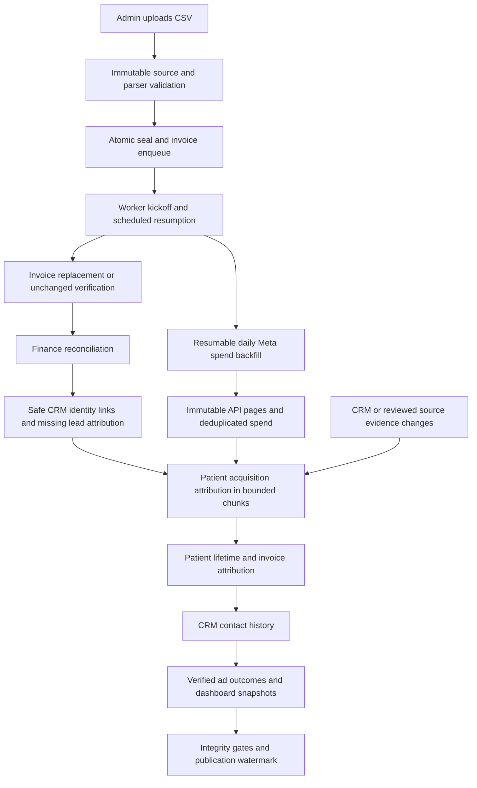

# MIS ingestion: production operation

The production upload page is available at https://project-sbcum.vercel.app/admin/mis-upload. Active administrators can upload the approved UTF-8 CSV, review validation and reconciliation status, and retry eligible failed invoice jobs. Processing runs in the configured overnight window.

The original source file and normalized rows are retained as append-only evidence. Every upload is treated as an authoritative snapshot for invoices present in that file: included invoices are fully replaced, while absent invoices are unchanged. Exact file replays resume their original receipt. Verify the export before upload because the format has no revision marker to identify an accidental stale snapshot.

Uploads must match the approved MIS export structure and fit within the 20 MiB / 50,000-row limit. Select the correct age reference year. Any rejected row prevents the invoice batch from entering the worker. Review invoice-level errors and resolve them before retrying.

The worker runs on the configured overnight schedule. Database checks enforce the Dhaka processing window. Canonical invoices commit individually; finance, patient lifetime attribution, CRM contact history, and dashboard summaries publish in later stages. Wait for the upload status to show downstream publication complete before treating reports as current.

After upload, reconcile signed source totals and invoice counts against the protected review view. Investigate failed jobs and confirm that the queue drains and the same file remains unchanged.

## Automated downstream workflow

Finalization atomically seals the immutable parse and queues valid invoices. The response starts the bounded worker, and the existing overnight cron resumes unfinished work. Every invocation attempts the resumable Meta spend sync, then drains the MIS queue within its remaining time budget. Database processing-window checks still apply.

Acquisition uses original, eligible evidence at or before first clinical conversion. Phone-only ambiguity, unreviewed Meta candidates, administrative import dates, late evidence, and tied conflicting sources remain explicit dispositions. Old authentication, source, and campaign fields are cleared when their evidence no longer qualifies. Revenue is allocated once per invoice; appointment and phone joins cannot multiply it.

## Monitoring and manual recovery

Open an accepted upload to see invoice counts, publication stage, marketing patient progress, coverage reasons, spend freshness, and outstanding Meta identity reviews. **Refresh sources and reconciliation** queues a fresh source revision and starts the same worker. It does not reimport or duplicate canonical invoices. It remains subject to the configured database processing window.

Spend synchronization uses the existing Meta token and enabled ad-account catalog. It checkpoints weekly windows and pages, supports USD and BDT separately, catches up through yesterday in the account timezone, then refreshes the previous seven days daily. Each API page is retained immutably. External API failures appear in spend status while MIS processing continues. Do not treat an old spend date or a failed account status as zero advertising activity.

`marketing_daily_spend` is the canonical daily insights cache. Verified rows also project into `meta_ad_spend_daily` for older reporting consumers. The compatibility projection requires a matching immutable API observation and keeps account, ad, date, currency and amount aligned. Its deployment captures the previous legacy cache in an immutable private baseline; older history absent from the current insights cache is retained. Manual or unverified cache rows cannot authenticate a projected amount.

Review suggested Meta identities in the existing review workflow. A CSV cannot create a missing historical referral or prove which person used a shared phone. Correcting or confirming evidence automatically invalidates downstream publication; the worker rebuilds attribution and revenue on its next run.

See [production acceptance and rollback](mis-upload-production-readiness.md) for release checks and current limitations.
