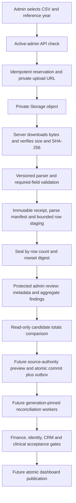

# MIS CSV ingest: production-readiness sequence

Status (2026-10-24): **canonical ingestion implemented locally; deployment verification pending**. The user approved authoritative complete-invoice uploads. The current implementation and exact activation sequence are in [mis-upload-gateway-rollout.md](mis-upload-gateway-rollout.md). That document supersedes the earlier proposal below where it differs, including authority, retry behavior, implemented migration IDs and publication limitations. Production data and schedules have not been changed by this implementation.

## Live state checked 2026-10-24

The Vercel project `project-sbcum` has a READY production deployment from `main` at commit `dac11f5e150b0d04d5d508448235d4d61cd5bb00`. The production environment has `MIS_UPLOADS_ENABLED=true` and the server-only Supabase service credential configured. The Supabase production ledger contains 611 migrations through `20261024104429`; the immutable intake and six security-hardening migrations are applied. The upload staging tables currently contain zero receipts, parses, staged rows, and validation findings. The review-detail and diagnostic candidate-preview migrations remain the only pending entries in this branch's deployment allowlist.

The current production capability is therefore **CSV source intake and staging only**. It does not update `public.mis_reports`, reconcile downstream finance/CRM data, or publish new dashboard generations. The latest read-only Vercel environment inventory and Supabase catalog checks show the expected server-only RPC path; a linked Supabase CLI dry run could not run because this shell has no Supabase CLI access token. The connected Supabase MCP confirms the live migration ledger and schema but does not provide a migration dry-run operation.

## Recommendation

Ship this in two operationally separate releases. First make **private, auditable CSV intake and admin review** reliable. Then, after finance and the MIS exporter approve the source contract, build **versioned canonical commits and generation-based downstream reconciliation**. Do not describe the first release as an MIS data import: it only preserves and stages a source file.

The current repository evidence identifies three release blockers for canonical writes:

1. The current export has no stable line ID, source revision/as-of marker, or completeness declaration. `(invoice_id, item_id)` is only a candidate key; it cannot establish whether repeated rows are valid charges or whether an absent line was deleted.
2. The current worker and repair design is import-owner based. It can miss same-import corrections and cannot safely rebuild a whole invoice whose lines came from multiple files.
3. The local migration history does not reconstruct the complete live schema. The existing scope and baseline notes record hundreds of live migration versions without source files. A migration dry run or clone cannot be trusted until that drift is explained or replaced with a schema-first baseline.

## Ingest pipeline and write boundaries

### Release 1: source intake and review

The admin API rechecks the authenticated user against the current active-admin profile. The server controls the receipt ID, storage path, file hash, parse manifest, and source row digests. Storage is private and source evidence is retained. Parser and row staging are bounded; seal verifies the row count and deterministic rowset hash. The admin review surface returns receipt metadata, parser versions, row disposition counts, and aggregate validation findings only; it does not return patient rows or write to `mis_reports`. A read-only comparison groups sealed rows by invoice and compares row counts and signed financial aggregates with current MIS. Every classification is explicitly a candidate; it cannot approve or perform a write because the source authority and completeness contract is missing.

Before enabling this release, resolve the migration baseline, verify the authorization migration and storage policies on an isolated schema-faithful database, apply the allowlisted additive migrations through the normal release process, configure server-only service credentials, validate the Vercel function duration for the largest supported file, and test the actual Vercel preview with an admin and a non-admin. Keep the intake flag off until those checks pass. Keep canonical-commit and worker flags absent/off.

### Release 2: authoritative source versions and canonical commit

Obtain a signed-off data contract from Finance and the exporter owner covering source/facility namespace, line grain and stable identity, monotonic correction authority, delta versus complete-invoice snapshots, omission/deletion semantics, void/refund/reversal behavior, money precision and rounding, collection definitions, dates/timezone, age reference year, and patient/admission reassignment. If the exporter cannot provide an immutable line identifier, prove that the approved aggregate key is unique and semantically stable using fixtures; otherwise ambiguous invoices remain quarantined for explicit reviewed resolution.

Implement immutable source versions and an invoice head with compare-and-swap authority. A deterministic preview must account for every row as accepted, unchanged, rejected, duplicate-under-approved-semantics, or conflict. It must show complete before/after invoice totals and all lines, not just the uploaded rows. One database transaction must write the source version, canonical `mis_reports` ownership/version mapping, and durable affected-invoice outbox events. Stale previews and lower/equal conflicting revisions abort atomically. No upload request may reconcile downstream tables inline.

### Release 3: affected-invoice downstream processing and publication

Replace import-ID invalidation with durable work keyed by invoice identity and source generation. Process the complete invoice and its old/new patient, admission, date-range, CRM, clinical, attribution, and dashboard dependencies. Use bounded transactions, durable attempts, leases/fencing, checkpoints, retries, dead-letter/review states, and generation checks. Validate signed financial measures independently; verify clinical attendance only from approved qualifying evidence; recalculate both former and new patient attribution when identity/date changes.

Build candidate outputs pinned to one generation and one CRM evidence watermark. Gate finance, CRM, attribution, coverage and dashboard snapshots before atomically switching the publication pointer. Every existing scheduled and manual refresh path must use that same gate. Keep the last validated publication visible whenever a generation is incomplete or fails.

## Ordered delivery and production gates

| Order | Deliverable | Acceptance gate |
|---|---|---|
| 0 | Reconcile live and local migration history; recover exact migration sources or build and prove a schema-first clone | Clean clone and allowlisted dry run match the intended live schema; no broad history repair or unreviewed pending migration application |
| 1 | Protect profile authorization controls and confirm every admin grant path | Self-role elevation/reactivation denied; authorized role management and legitimate profile workflows pass |
| 2 | Verify immutable intake schema, grants, Storage privacy, upload reservation, parser, finalizer, and review RPC | Clone tests prove append-only evidence, exact-file idempotency, row/hash integrity, admin-only access, non-admin denial, safe retry and PII-minimized review |
| 3 | Ship Vercel code with all MIS upload flags disabled | CI, parser tests, database assertions, optimized build and preview E2E pass on the exact commit; secrets remain server-only |
| 4 | Enable source-only intake as a separate controlled action | One approved test file stages and seals; matching duplicate is idempotent; canonical MIS, finance, CRM and snapshots remain unchanged |
| 5 | Approve source contract and implement preview/version/commit/outbox migrations | Approved fixtures prove stale/equal authority, row identity, whole-invoice replacement, correction, deletion, void/refund, concurrency, rollback, and idempotent response behavior |
| 6 | Implement worker/dependency closure and candidate publication | Full historical replay finishes with measured overnight headroom; zero out-of-window writes, lost work, mixed generations, false attendance, and financial mismatch |
| 7 | Shadow run, canary, then separately approved activation | Two overnight cycles and a historical correction pass; Finance/CRM sign the same source and publication manifest; rollback and restore drills are verified |

## Rollout and rollback

Deploy additive, reviewed schema before deploying code that references it. Apply one migration at a time after verifying project identity, exact SQL, backup/PITR, lock impact, grants, triggers, and post-migration assertions. Do not edit cron schedules as part of the intake release. Do not enable canonical commit or workers merely because the UI is live.

Before canonical commit, rollback means disabling intake and retaining receipts, rows, and objects. After a source commit but before publication, stop new commits and worker claims while preserving the last good publication; recover with a reviewed compensating generation, not deletion or ownership rewrites. After publication, move the publication pointer only to a retained validated generation. Schema rollback is forward-compatible repair; never delete source evidence or restore insecure authorization grants.

## Implemented in this slice

- Parser validation now matches the current canonical `mis_reports` required-field contract and requires an explicitly supplied age reference year.
- Finalize returns aggregate field/code validation counts.
- Admin review-detail RPC/API/UI exposes parse metadata and aggregate counts without returning staged patient fields.
- Admin-only candidate comparison reports new, matching-aggregate, changed-aggregate, or repeated-item-key invoice candidates; the result is marked diagnostic-only and the database RPC hard-codes `canonicalWriteAllowed = false`.
- The source contract and future canonical promotion gates are documented in `mis-upload-gateway-source-contract-v1.md`.

These changes remain local. They do not apply migrations, deploy Vercel code, enable intake, write canonical MIS data, run reconciliation, or alter cron schedules. The full Next.js build has also encountered a Windows `EPERM` while creating generated API build directories in this synchronized workspace; a clean CI or non-synchronized preview build remains a release gate.
